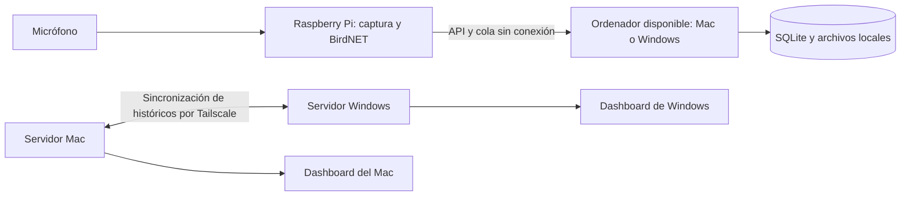

# BirdMonitor — TFG de monitorización acústica de aves

Sistema de monitorización con Raspberry Pi, BirdNET, una API FastAPI y un
dashboard web. La Raspberry graba y analiza el audio; los ordenadores conservan
el histórico y permiten consultar detecciones, métricas, evidencias y revisiones.

Este README documenta el repositorio completo. Los comandos parten de
`TFG-monitoreo-aves/`, salvo que se indique otro directorio.

## Arquitectura y estado actual



Cada ordenador tiene su propia base SQLite. `localhost:8000` siempre abre el
servidor de ese ordenador, no una base común. Tailscale proporciona conectividad
privada; BirdMonitor implementa la transferencia y los reintentos.

| Componente | Estado |
|---|---|
| Captura, BirdNET, métricas y cola offline del nodo | Implementado |
| Dashboard, revisión humana, ubicaciones, exportaciones y directo | Implementado |
| Arranque automático en Mac, Windows y Raspberry | Implementado; requiere instalar los servicios en cada equipo |
| Sincronización incremental de detecciones y métricas entre ordenadores | Primera fase implementada; se activa configurando los pares |
| Recuperación de WAV y PNG desde otro ordenador | Implementada, con comprobación SHA-256 y reintentos independientes |
| Selección automática de un ordenador disponible por la Raspberry | Implementada para detecciones, métricas y archivos; requiere configurar los destinos de ingesta |
| Retención de archivos en la Raspberry | Se mantiene la limpieza existente por días y la protección de archivos pendientes de envío; no se añade una cuota de GB |
| Sincronización de revisiones, reglas de aprendizaje y cambios administrativos | Pendiente |

La sincronización está implementada en el código y probada con bases independientes.
Actualizar el código no activa por sí solo los pares ni los destinos de la Raspberry:
hay que configurar las credenciales y reiniciar los servicios de cada instalación.

## Cómo se actualizan Mac y Windows

Cada servidor consulta los pares configurados al arrancar y después cada 60
segundos. Descarga únicamente los registros posteriores al último cursor guardado.
Las páginas se aplican en una transacción junto con el cursor; un fallo permite
reintentar sin dar por recibido lo que no se guardó.

Los identificadores numéricos de una base no se copian a la otra. Los registros
se relacionan mediante el nombre del nodo, el código del sitio y el UUID del
despliegue. La identidad del evento utiliza ese contexto, la fecha, el archivo y,
en las detecciones, la especie. Los reintentos y la retransmisión de un mismo
registro desde un tercer ordenador no crean una detección adicional.

Los archivos se descargan por separado, por bloques, a un temporal en el disco de
destino. Solo se publican después de comprobar su SHA-256. Un archivo ausente,
una desconexión o un error de integridad conserva el trabajo pendiente. Un archivo
local con contenido diferente no se sobrescribe.

### Ejemplo: Windows lleva diez días apagado

1. El Mac recibe y conserva los registros y los archivos enviados por la Raspberry.
2. Windows vuelve a arrancar con su backend y Tailscale activos.
3. Si el Mac está conectado, Windows recupera su histórico pendiente, aunque esos
   audios ya no estén en la Raspberry.
4. Si el Mac está apagado, la recuperación espera. Haberlo encendido el día anterior
   no hace accesible su disco mientras está apagado.
5. Cuando ambos coinciden conectados, la transferencia se reanuda automáticamente.

Para que la comunicación funcione en ambos sentidos, cada ordenador debe incluir
al otro en su configuración. Un servidor puede retransmitir los datos que recibió
de otro. No se propagan eliminaciones: esta fase añade histórico y conserva las
copias que ya existen.

### Límites de esta primera fase

- Se transfieren detecciones y métricas nuevas, incluido el histórico existente al
  conectar un par por primera vez. No se replican posteriores modificaciones de
  un registro ya descargado ni sus revisiones humanas.
- Se incorpora el contexto de sitio y despliegue necesario para interpretar cada
  registro. Las órdenes de cambio de ubicación, el control del directo y las
  credenciales de acceso no se copian entre servidores.
- Si un UUID de despliegue corresponde a otro nodo/sitio, o un sitio tiene
  coordenadas distintas, la importación se detiene para ese par. Se conserva el
  contenido local y no se avanza su cursor sobre la página conflictiva.
- Los nombres de nodo distintos no se fusionan automáticamente. Si se ha comprobado
  que son el mismo hardware, `scripts/reconcile_legacy_replica.py` permite revisar
  y aplicar una reconciliación concreta, con copia de seguridad y comprobación de
  integridad. Una identidad de hardware independiente del nombre queda pendiente.
- La disponibilidad de registros no garantiza que existan sus WAV y PNG. Si nunca
  se subieron o se borraron de todas las copias, no pueden reconstruirse.
- No copies un archivo SQLite para crear una segunda réplica activa: copiarías
  también su identidad y sus cursores. Configura otra instalación e importa los
  datos mediante la sincronización.
- La sincronización no sustituye una copia de seguridad externa.

### Reconciliar una migración antigua

La migración legacy calculaba el UUID del despliegue a partir del sitio y del
identificador numérico local del dispositivo. Por ello, compartir ese UUID no
demuestra por sí solo que dos bases describan el mismo hardware. Antes de unirlas,
comprueba el nodo físico, el sitio y los intervalos de observación de ambos equipos.

`scripts/reconcile_legacy_replica.py --help` muestra los parámetros del plan:
base de datos, UUID, nombre común, alias, sitio y fechas de inicio y cierre.
Sin `--apply` solo muestra el cambio previsto. Con `--apply`, guarda una copia
SQLite, comprueba que ninguna observación quede fuera del intervalo y aplica la
reconciliación en una transacción. Conserva las detecciones, las métricas y las
revisiones locales, y comprueba las referencias entre tablas. Si el alias tiene
otros despliegues, se detiene para exigir una revisión individual.

Aplica el mismo contexto verificado a ambos históricos antes de reintentar la
sincronización. Las diferencias de formato de fechas legacy y los eventos
repetidos dentro de una página no crean una observación adicional al importarlos.

## Almacenamiento de la Raspberry

La Raspberry conserva una cola SQLite en `offline_outbox.db`. Actualmente elimina
cada evento pendiente cuando el servidor configurado lo acepta. Esa cola **no es
un histórico completo ni una confirmación de que ambos ordenadores tengan copia**.

Los medios locales tienen una retención configurable con
`BIRDMONITOR_RETENTION_DAYS` (valor inicial: 9 días). La limpieza omite los WAV y
PNG cuyo nombre aparece en eventos pendientes de tipo `detection` o
`file_upload`, aunque superen esa antigüedad. Los demás archivos se eliminan
cuando superan los días configurados. No es una protección de todos los audios
por el simple hecho de estar sin conexión.

Se reutiliza esa retención para conectar los ordenadores: no se añade una cuota
de GB ni se amplía el plazo para esperar al ordenador que lleva días apagado.
Una vez que un ordenador conserva los registros y archivos, el otro puede
recuperarlos de él cuando ambos estén conectados, aunque la Raspberry ya los
haya eliminado. La sincronización entre ordenadores no exige guardar una copia
adicional en la Raspberry.

La retención por días no limita los GB: los archivos pendientes pueden seguir
acumulándose si el nodo no consigue entregarlos. Mientras ambos ordenadores están
apagados, la captura continúa y los envíos quedan en espera. Al volver uno, se
vacía la cola por lotes; no se espera a que ambos tengan copia para confirmar un
envío. Si la cola no puede leerse, la limpieza se aplaza para no borrar archivos
cuya entrega no se puede comprobar.

El almacenamiento ocupado no es la principal fuente de calor: la carga de
inferencia, la actividad de escritura y la refrigeración también importan. La
replicación de históricos de esta fase se ejecuta en los ordenadores.

## Preparar un servidor

### Dependencias

Python 3.11 o posterior para el backend y MediaMTX para el audio en directo.
La inferencia BirdNET se instala por separado en la Raspberry.

macOS, desde la raíz del repositorio:

```bash
cd monitoreo_aves
python3 -m venv venv
./venv/bin/python -m pip install -r requirements.txt
./venv/bin/python scripts/configure_security.py
./venv/bin/python scripts/configure_network_mode.py --mode tailscale --server-host IP_TAILSCALE_DE_ESTE_MAC
./venv/bin/python scripts/configure_stream_security.py
```

Windows, desde la raíz del repositorio:

```powershell
Set-Location monitoreo_aves
python -m venv venv
.\venv\Scripts\python.exe -m pip install -r requirements.txt
.\venv\Scripts\python.exe scripts\configure_security.py
.\venv\Scripts\python.exe scripts\configure_network_mode.py --mode tailscale --server-host IP_TAILSCALE_DE_ESTE_PC
.\venv\Scripts\python.exe scripts\configure_stream_security.py
```

Utiliza la IP del propio ordenador, no la de la Raspberry. Conserva el token del
nodo y la contraseña RTSP de publicación para configurar la Raspberry. No vuelvas
a generar esas credenciales en una instalación existente salvo que quieras rotarlas.

Para cambiar únicamente la contraseña del dashboard, desde `monitoreo_aves/`:

```bash
./venv/bin/python scripts/configure_security.py --password-only
```

En Windows usa `.\venv\Scripts\python.exe` en lugar de `./venv/bin/python`.
Introduce la nueva contraseña dos veces en el terminal (entre 12 y 256 caracteres;
no se muestra al escribir). Este modo conserva el usuario, la red y todas las
claves del nodo, streaming y sincronización. Guarda únicamente el hash de la
contraseña y renueva la clave de sesión para cerrar las sesiones anteriores.
Reinicia el backend para aplicar el cambio. En macOS, con el servicio instalado:

```bash
launchctl kickstart -k "gui/$(id -u)/com.birdmonitor.services"
```

Cada ordenador mantiene su propia contraseña: cambiarla en uno no modifica el otro.

### Arranque automático en macOS

El proyecto operativo debe estar fuera de `Desktop`, `Documents` y `Downloads`,
por ejemplo en `~/Projects/TFG-monitoreo-aves`. Coloca el binario Darwin de MediaMTX
en `monitoreo_aves/tools/mediamtx/macos/mediamtx`.

Desde `monitoreo_aves/`:

```bash
chmod +x tools/mediamtx/macos/mediamtx
bash scripts/macos/install_birdmonitor_macos.sh
bash scripts/macos/check_birdmonitor_macos.sh
```

La tarea `com.birdmonitor.services` arranca al iniciar sesión y recupera el backend
y MediaMTX si uno termina. El instalador comprueba el servicio HTTP y su
configuración antes de confirmar el éxito. El lanzador evita la suspensión
automática mientras el Mac está conectado a corriente; no evita la suspensión
por cerrar la tapa.

### Arranque automático en Windows

Coloca MediaMTX en `monitoreo_aves/tools/mediamtx/mediamtx.exe`. Desde
`monitoreo_aves/`, abre PowerShell como administrador:

```powershell
.\scripts\windows\install_birdmonitor_windows.ps1
.\scripts\windows\check_birdmonitor_windows.ps1
```

Se registran las tareas `BirdMonitor Backend` y `BirdMonitor MediaMTX`. Los logs
están en `%LOCALAPPDATA%\BirdMonitor`; en macOS, en
`~/Library/Application Support/BirdMonitor`.

### Acceso

- Dashboard local: `http://localhost:8000`.
- Dashboard remoto: `http://IP_TAILSCALE_DEL_ORDENADOR:8000`.
- Salud del servidor: `http://localhost:8000/health`.

El dashboard se sirve desde FastAPI y consulta datos nuevos cada cuatro segundos.
La frecuencia de captura de la Raspberry es independiente: inicialmente, 60
segundos de audio cada cinco minutos.

## Configurar la sincronización entre ordenadores

Instala esta misma versión del backend en ambos equipos y conserva una copia de
seguridad de sus bases y medios antes de la primera sincronización. Los servicios
deben ser accesibles por sus IP privadas mediante Tailscale o una LAN privada.

Todos los comandos siguientes se ejecutan desde `monitoreo_aves/`. En macOS se usa
`./venv/bin/python`; en Windows, `.\venv\Scripts\python.exe`.

### 1. Crear una credencial de réplica en cada servidor

```bash
./venv/bin/python scripts/configure_replication.py
```

El script conserva las credenciales de administrador, nodo y streaming. Crea una
credencial independiente, guardada en `backend/replication-access.secret`, y su
hash en `backend/birdmonitor.env`. Repetir el comando no rota el token existente.

Ese token autoriza únicamente la lectura de los datos y medios de replicación;
no permite modificar detecciones, acceder al dashboard ni controlar la Raspberry.

### 2. Añadir Windows como origen en el Mac

```bash
./venv/bin/python scripts/configure_replication.py --peer-name windows --peer-url http://IP_TAILSCALE_WINDOWS:8000
```

Cuando lo solicite, introduce el token del archivo `replication-access.secret`
**de Windows**. No lo incluyas como argumento del comando.

### 3. Añadir el Mac como origen en Windows

```powershell
.\venv\Scripts\python.exe scripts\configure_replication.py --peer-name mac --peer-url http://IP_TAILSCALE_MAC:8000
```

Introduce el token **del Mac**. Los pares se guardan en
`backend/replication-peers.secret`, excluido de Git. Las variables utilizadas son:

```dotenv
BIRDMONITOR_REPLICATION_TOKEN_HASH=sha256$HASH_GENERADO
BIRDMONITOR_REPLICATION_PEERS_FILE=replication-peers.secret
BIRDMONITOR_REPLICATION_INTERVAL_SECONDS=60
```

Solo se admiten orígenes HTTP(S) con IPv4 de Tailscale, LAN privada o loopback.
No se siguen redirecciones ni se utilizan proxies del entorno para estas peticiones.
No hace falta abrir puertos en el router. Revisa el Firewall del equipo si el
puerto `8000` no es accesible desde el otro ordenador.

### 4. Reiniciar y comprobar

macOS:

```bash
launchctl kickstart -k "gui/$(id -u)/com.birdmonitor.services"
```

Windows:

```powershell
.\scripts\windows\repair_backend_task.ps1
```

La sincronización se ejecuta dentro del backend y utiliza un bloqueo por base de
datos para que dos procesos no importen simultáneamente. Cada ciclo limita las
páginas y los archivos descargados; los pendientes continúan en ciclos posteriores.

Con una sesión administradora abierta, consulta `/sync/status` en el mismo origen
del dashboard. Muestra la identidad de la réplica, los cursores por origen y los
archivos pendientes. Los logs indican qué par está pendiente si está apagado,
falla su autenticación o hay un conflicto.

## Configurar la Raspberry

La guía de hardware está en
[monitoreo_aves/hardware/raspberry_pi/README.md](monitoreo_aves/hardware/raspberry_pi/README.md).
Sus comandos deben adaptarse al clon real: en este repositorio, el código de la
aplicación está dentro de `monitoreo_aves/`.

Los tres procesos son:

| Unidad | Función |
|---|---|
| `birdmonitor.service` | Captura, BirdNET, métricas y cola offline |
| `birdstream.service` | Publicación RTSP autenticada |
| `birdmonitor-stream-supervisor.service` | Aplica las órdenes de directo del servidor |

La configuración privada se guarda en `/etc/birdmonitor/birdmonitor.env`. El
micrófono compartido `micshared` permite que captura y directo lo usen a la vez.

### Enviar al ordenador disponible

Primero actualiza los dos backends a esta versión y configura su sincronización
mutua. En cada servidor puedes crear una credencial adicional exclusiva para
recibir datos del nodo, sin cambiar el usuario, la contraseña ni el token anterior:

```bash
./venv/bin/python scripts/configure_replication.py --enable-node-ingest
```

En Windows usa `.\venv\Scripts\python.exe`. El token se guarda en
`backend/ingest-access.secret`; solo permite registrar el contexto de despliegue
y subir detecciones, métricas y archivos. No permite leer el histórico ni controlar
el directo. El token de réplica y el de ingesta tienen funciones distintas.

En la Raspberry, desde `monitoreo_aves/hardware/raspberry_pi/`, utiliza el Python
del entorno del nodo para ejecutar:

```bash
sudo /RUTA/AL/ENTORNO/bin/python tools/configure_delivery.py --name windows --url http://IP_TAILSCALE_WINDOWS:8000
sudo systemctl restart birdmonitor.service
```

Introduce en el terminal el token de ingesta de Windows. El configurador conserva
el servidor y el token actuales como primer destino, añade Windows y guarda
`ingest-targets.secret` con permisos restringidos y lectura para el propietario
de la carpeta del nodo. La variable `BIRDMONITOR_INGEST_TARGETS_FILE` de
`/etc/birdmonitor/birdmonitor.env` apunta a ese archivo. Puedes repetir el comando
con la misma IP para actualizar su credencial. Reinicia el nodo tras cambiarla.

Con esta opción activa, cada detección o métrica se guarda primero en la cola
SQLite, junto con su contexto original. El nodo prueba los destinos disponibles
y prefiere el último que aceptó una entrega. Si falla la conexión, espera al menos
60 segundos antes de volver a probar ese destino. La cola se procesa por lotes de
50 eventos en los ciclos de captura y al enviar nuevas observaciones.

Las peticiones de metadatos usan tres segundos para conectar. Las subidas WAV/PNG
permiten 60 segundos: `requests` también aplica ese tiempo al envío del cuerpo,
y tres segundos pueden cortar un WAV válido cuando Tailscale transfiere despacio.
La espera de respuesta es de 60 segundos en ambos casos. El histórico multimedia
se copia por lotes; ver una detección sincronizada no significa que su WAV ya haya
llegado. Un archivo ausente en ambos ordenadores solo puede recuperarse si aún
existe en la Raspberry o en una copia de seguridad.

Una detección solo sale de la cola cuando un mismo ordenador confirma el registro
y la subida de su WAV y los PNG disponibles. Si el envío se interrumpe, se conserva
el evento completo y puede reenviarse al otro ordenador sin duplicar la detección.
Las métricas requieren confirmar también su versión cuando son `maad-v2`.
El registro del despliegue respeta su UUID y no reactiva una campaña histórica.

Los antiguos pendientes `file_upload` que solo conservan un nombre de archivo
se entregan al servidor original: no contienen la detección completa para crearla
en otro. Los eventos antiguos sin contexto completo necesitan que el destino ya
conozca su despliegue; si no lo conoce, quedan pendientes hasta sincronizarlo.

Sin `BIRDMONITOR_INGEST_TARGETS_FILE`, el nodo conserva el funcionamiento con un
único servidor. El directo RTSP y las órdenes de cambio de ubicación siguen usando
el servidor principal; esta selección automática afecta a la entrega de datos.

## Datos, pruebas y estructura

| Contenido | Ubicación dentro de `monitoreo_aves/` |
|---|---|
| Backend y migraciones | `backend/app/` |
| Base SQLite | `backend/app/birdmonitor.db` |
| Configuración privada | `backend/birdmonitor.env` |
| Dashboard | `frontend/` |
| Código del nodo e inferencia | `hardware/raspberry_pi/node/` |
| Configuradores del nodo | `hardware/raspberry_pi/tools/` |
| Audios y espectrogramas del servidor | `hardware/raspberry_pi/records/` y `spectrograms/` |
| Replicación | `backend/app/features/replication/` |
| Instaladores | `scripts/macos/`, `scripts/windows/`, `scripts/raspberry_pi/` |
| Pruebas | `tests/` |

La carpeta de hardware separa el código y las herramientas de los datos:

```text
hardware/raspberry_pi/
├── mainNode.py              # Entrada del servicio de captura
├── supervisor.py            # Entrada del supervisor de streaming
├── node/                    # Captura, BirdNET, configuración, ubicación y envío
├── tools/                   # configure_site.py y configure_delivery.py
├── model/                   # Archivos de modelos y etiquetas
├── records/                 # WAV locales, fuera de Git
├── spectrograms/            # PNG locales, fuera de Git
├── birdmonitor.env.example
└── README.md
```

Dentro de `node/`, `main.py` coordina el ciclo; `audio_processing.py` y
`analyzer.py` capturan y analizan; `node_sync.py` y `node_delivery.py` gestionan
la cola y el envío; `node_config.py`, `deployment_context.py` y `node_location.py`
mantienen la configuración y el despliegue. `birdweather_client.py` integra
BirdWeather y `supervisor.py` controla el directo.

Los puntos de entrada de systemd mantienen sus nombres y rutas. El archivo local
`birdmonitor.env`, la cola `offline_outbox.db`, `deployment_state.json`, la caché
de ubicación y `ingest-targets.secret` siguen en `hardware/raspberry_pi/` cuando
existen. Mover el código no crea una cola nueva ni cambia dónde se buscan los WAV.
Los configuradores se ejecutan ahora desde `tools/`; al actualizar una instalación
hay que copiar el paquete `node/` completo junto con los puntos de entrada y
reiniciar los servicios. Sustituir únicamente `mainNode.py` no es suficiente.

Los WAV, PNG, SQLite y secretos no se versionan. No sincronices el archivo SQLite
mediante una carpeta compartida: la transferencia de esta fase utiliza la API y
transacciones locales, no una sustitución de bases de datos.

Pruebas del nuevo flujo, desde `monitoreo_aves/` y con `pytest` instalado:

```bash
./venv/bin/python -m pytest tests/test_replication.py tests/test_node_delivery.py tests/test_reconcile_legacy_replica.py tests/test_security.py tests/test_network_security.py -q
```

Se comprueban bases con identificadores distintos, recuperación del histórico sin
la Raspberry, retransmisión desde otro ordenador, reintentos, archivos tardíos,
conflictos de contexto, integridad de archivos, autorización independiente,
conservación de la cola al reiniciar y entrega completa al ordenador disponible.
Las pruebas usan bases temporales y desactivan los pares de una instalación real.

Una clasificación de BirdNET es una hipótesis: la confianza, la evidencia acústica
y la revisión humana forman parte de su interpretación. No equivale por sí sola
a un censo de aves.

Referencias técnicas: [ciclo de vida de FastAPI](https://fastapi.tiangolo.com/advanced/events/),
[transporte HTTPX y pruebas](https://www.python-httpx.org/advanced/transports/),
[conectividad de Tailscale](https://tailscale.com/docs/how-to/connect-to-devices).
